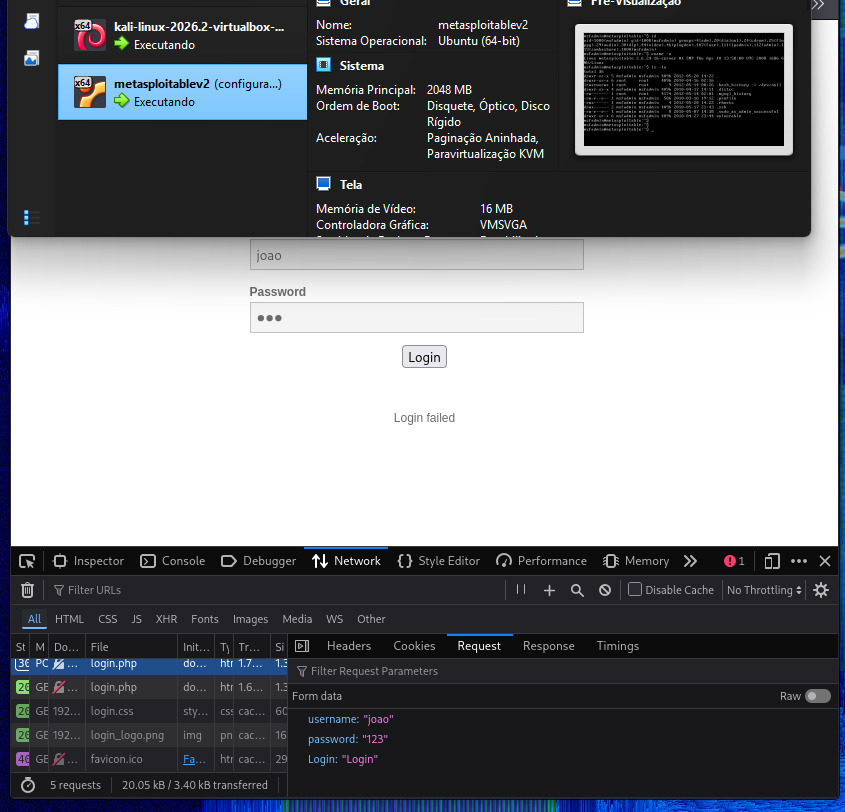
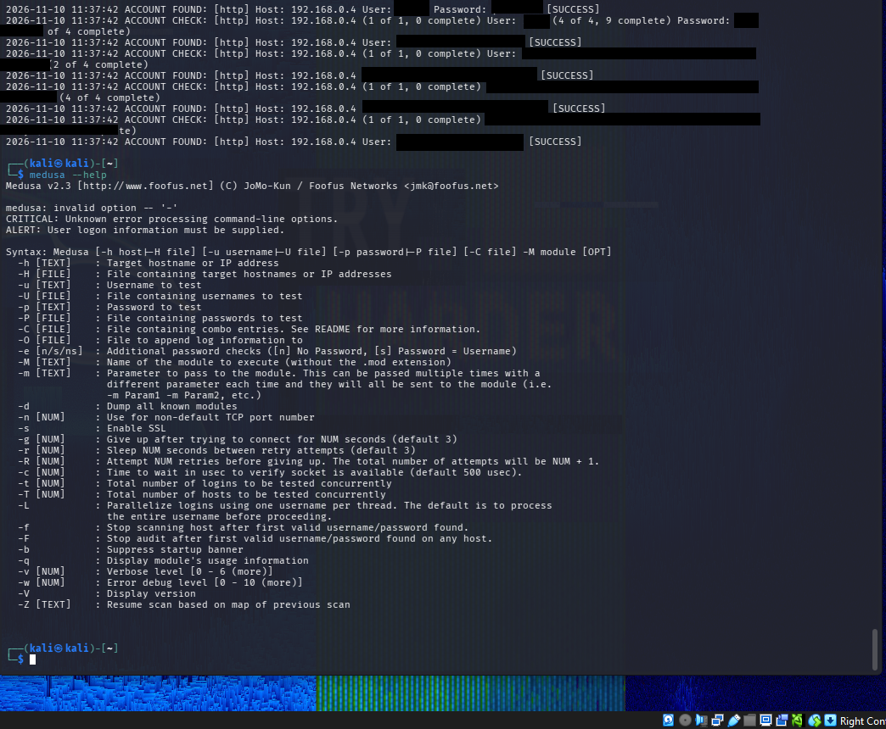

# Simulação de Força Bruta com Medusa e Kali Linux

## Sobre o projeto

Este projeto foi desenvolvido como atividade prática de Segurança da Informação, com o objetivo de conhecer e demonstrar o funcionamento de ataques de força bruta utilizando a ferramenta Medusa no Kali Linux.

## Ferramentas utilizadas

- Kali Linux
- Medusa
- VirtualBox

## Desenvolvimento

O ambiente de testes foi montado utilizando máquinas virtuais no VirtualBox. Foram realizados testes controlados para observar o funcionamento da ferramenta Medusa e entender como ocorre uma tentativa de acesso por força bruta.

## Evidências

### 1. Ambiente VirtualBox painel DVWA

### 2. Execução do teste com Medusa

## Conclusão

A atividade permitiu conhecer melhor a ferramenta Medusa, entender como funcionam os ataques de força bruta e observar a importância de utilizar senhas seguras e mecanismos de proteção contra tentativas de acesso não autorizadas.
